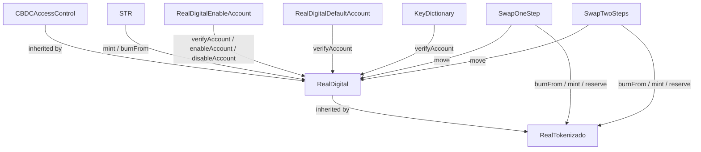

# Contracts Reference

What each smart contract of the Real Digital (Drex) pilot does, who can call each function and what it depends on.

Source: [wireshape/real-digital-smart-contracts](https://github.com/wireshape/real-digital-smart-contracts), a Wire Labs reconstruction of the contracts based on the ABIs released by Banco Central do Brasil (BCB) for the Real Digital pilot. It is **not** the official BCB implementation.

For step-by-step flows (which contract and function to call, in which order, for each use case), see [use-case-flows.md](use-case-flows.md).

---

## Overview

| Contract | Type | Role in the system |
|---|---|---|
| [CBDCAccessControl](#cbdcaccesscontrol) | abstract | Roles and wallet allow-list shared by every token |
| [RealDigital](#realdigital) | ERC20 token | Wholesale CBDC (Real Digital), held by BCB and participants (banks) |
| [RealTokenizado](#realtokenizado) | ERC20 token | Tokenized deposit of one participant (one contract per bank), held by its clients |
| [STR](#str) | service | Simulates the STR (BCB's reserve transfer system): participants mint/burn Real Digital |
| [SwapOneStep](#swaponestep) | service | Inter-bank client transfer of Real Tokenizado in a single transaction |
| [SwapTwoSteps](#swaptwosteps) | service | Inter-bank client transfer of Real Tokenizado with propose → accept |
| [RealDigitalEnableAccount](#realdigitalenableaccount) | service | Lets an enabled participant enable more of its own wallets |
| [RealDigitalDefaultAccount](#realdigitaldefaultaccount) | registry | Default wallet of each participant, indexed by CNPJ8 |
| [KeyDictionary](#keydictionary) | registry | Directory mapping a client key (e.g. a hash of the CPF) to bank data and wallet |
| [AddressDiscovery](#addressdiscovery) | registry | Directory of deployed contract addresses |

### Dependencies

### Actors

| Actor | Description |
|---|---|
| **BCB authority** | Wallet passed as `_authority` to `RealDigital`. Holds ACCESS, MINTER, BURNER, MOVER and FREEZER roles. |
| **BCB admin** | Wallet passed as `_admin`. Holds `DEFAULT_ADMIN_ROLE` (grants/revokes roles) and `PAUSER_ROLE`. |
| **Participant** | Financial institution. Its wallet is enabled in `RealDigital`. Identified by its CNPJ8 (first 8 digits of the CNPJ). |
| **Reserve wallet** | Participant wallet holding the Real Digital that backs its Real Tokenizado. Stored in `RealTokenizado.reserve`. |
| **Client** | End user of a participant. Holds Real Tokenizado of that participant. |

### Units

Both tokens use **2 decimals**: `amount = 10050` means R$ 100,50.

---

## CBDCAccessControl

`abstract contract CBDCAccessControl is AccessControl` (OpenZeppelin).

Shared access layer for `RealDigital` and `RealTokenizado`. It does two things:

1. Defines the roles that control privileged token operations.
2. Keeps an allow-list (`_authorizedAccounts`) of wallets that may hold and move the token.

### Roles

| Role | Granted at deploy to | Allows |
|---|---|---|
| `DEFAULT_ADMIN_ROLE` | `_admin` | Grant/revoke every other role (`grantRole`, `revokeRole`) |
| `PAUSER_ROLE` | `_admin` | `pause()` / `unpause()` |
| `ACCESS_ROLE` | `_authority` | `enableAccount` / `disableAccount` |
| `MINTER_ROLE` | `_authority` | `mint` |
| `BURNER_ROLE` | `_authority` | `burn` (own balance) |
| `MOVER_ROLE` | `_authority` | `move`, `moveAndBurn` (move anyone's balance) |
| `FREEZER_ROLE` | `_authority` | `increaseFrozenBalance` / `decreaseFrozenBalance` |

The admin of `DEFAULT_ADMIN_ROLE` is set to `keccak256(_admin)`, a role nobody holds, so `DEFAULT_ADMIN_ROLE` itself cannot be granted to new wallets after deploy. The admin can still grant all other roles (their admin role is `DEFAULT_ADMIN_ROLE`).

### Functions

| Function | Who | Description |
|---|---|---|
| `enableAccount(address member)` | `ACCESS_ROLE` | Adds the wallet to the allow-list. Emits `EnabledAccount`. |
| `disableAccount(address member)` | `ACCESS_ROLE` | Removes the wallet from the allow-list. Emits `DisabledAccount`. |
| `verifyAccount(address account)` | anyone (view) | `true` if the wallet is enabled. Other contracts use it as the "is participant?" check. |

### Modifier `checkAccess(from, to)`

Used on every token movement. If `from != 0` it requires `from` to be enabled; otherwise (mint) it requires `to` to be enabled. **It does not check `to` on ordinary transfers.** See the caveats in [RealDigital](#realdigital).

---

## RealDigital

`contract RealDigital is ERC20, CBDCAccessControl, Pausable`

The wholesale CBDC. Only BCB and participants (banks) hold it. Constructor: `RealDigital(name, symbol, authority, admin)`.

On top of a regular ERC20 it adds:

- **Allow-list**: only enabled wallets can send (and receive minted tokens).
- **Frozen balance**: part of a wallet's balance can be locked; only `balance - frozen` can be spent.
- **Pause**: the admin can stop every operation.
- **Privileged operations**: mint, burn, and moving funds out of any wallet.

Every movement (`_transfer`, `_mint`, `_burn`) goes through `_beforeTokenTransfer`, which requires: not paused, enough unfrozen balance in `from`, and `checkAccess(from, to)`.

### Functions

| Function | Who | Description |
|---|---|---|
| `mint(to, amount)` | `MINTER_ROLE` | Creates `amount` in `to` (`to` must be enabled). **Also increases `allowance(to, caller)` by `amount`**, so the minter can later `burnFrom` that amount. |
| `burn(amount)` | `BURNER_ROLE` | Destroys tokens from the caller's own balance. |
| `burnFrom(account, amount)` | anyone with allowance | Destroys tokens from `account`, consuming the caller's allowance. No role required. |
| `move(from, to, amount)` | `MOVER_ROLE` | Transfers between any two wallets without the owner's approval. Used by the swap contracts. |
| `moveAndBurn(from, amount)` | `MOVER_ROLE` | Moves `amount` from `from` to the contract and burns it (forced redemption). |
| `transfer(to, amount)` | enabled wallet | ERC20 transfer. Requires the caller to be enabled. |
| `transferFrom(from, to, amount)` | spender with allowance | Requires **both** `from` and `to` to be enabled. |
| `approve(spender, amount)` | enabled wallet | ERC20 approve. |
| `increaseAllowance` / `decreaseAllowance` | enabled wallet | Atomic allowance changes. |
| `increaseFrozenBalance(wallet, amount)` | `FREEZER_ROLE` | Locks `amount` of the wallet's balance. Emits `FrozenBalance`. |
| `decreaseFrozenBalance(wallet, amount)` | `FREEZER_ROLE` | Unlocks `amount`. Emits `FrozenBalance`. |
| `frozenBalanceOf(wallet)` | view | Locked amount. |
| `pause()` / `unpause()` | `PAUSER_ROLE` | Blocks / unblocks every operation. |
| `decimals()` | view | Returns `2`. |
| `enableAccount`, `disableAccount`, `verifyAccount` | see [CBDCAccessControl](#cbdcaccesscontrol) | |

### Events

`Transfer`, `Approval` (ERC20), `FrozenBalance(wallet, amount)`, `EnabledAccount`, `DisabledAccount`, `Paused`, `Unpaused`, `RoleGranted`, `RoleRevoked`.

### Caveats (behavior of this implementation)

- `transfer` checks only that the **sender** is enabled; the recipient is not checked, so tokens can be sent to a wallet that is not enabled (and that wallet cannot move them afterwards). `transferFrom` checks both sides.
- `frozenBalances` is not capped by the balance: freezing more than the balance just makes the wallet unable to spend.
- `burnFrom` relies only on allowance. Because `mint` grants allowance to the minter, a contract that mints for a wallet (STR, swaps) can later burn up to that amount without a new `approve`.

---

## RealTokenizado

`contract RealTokenizado is RealDigital`

Tokenized bank deposit (DVt / MEt) issued by **one** participant. Each participant deploys its own instance. It inherits everything from `RealDigital` (allow-list, roles, freeze, pause, 2 decimals) and adds the participant's identification.

Constructor: `RealTokenizado(name, symbol, authority, admin, participant, cnpj8, reserve)`. `authority` gets the operational roles over this token (enable clients, mint, burn, move, freeze); in practice this is the issuing participant.

| Field / function | Who | Description |
|---|---|---|
| `participant` | view | Participant name. |
| `cnpj8` | view | First 8 digits of the participant's CNPJ. Used in swap events. |
| `reserve` | view | Participant wallet that holds the **Real Digital** backing this token. The swaps move Real Digital between reserves. |
| `updateReserve(newReserve)` | `DEFAULT_ADMIN_ROLE` | Changes the reserve wallet. |

The contract does not enforce that the Real Tokenizado supply is backed by Real Digital in `reserve`. Keeping that parity is up to the participant.

---

## STR

`contract STR` (constructor: `STR(RealDigital token)`)

Simulates the STR (Sistema de Transferência de Reservas). Lets a participant turn its bank reserves at BCB (an off-chain balance, not the `reserve` wallet of RealTokenizado) into Real Digital and back. In the pilot there is no validation other than the caller being enabled in `RealDigital`: the off-chain debit/credit of reserves is not simulated.

The participant does not need `MINTER_ROLE`: STR holds it and mints on the participant's behalf.

**Required setup:** STR needs `MINTER_ROLE` on `RealDigital`.

| Function | Who | Description |
|---|---|---|
| `requestToMint(amount)` | participant (enabled in RealDigital) | Mints `amount` of Real Digital to the caller. Because STR is the minter, `allowance(caller, STR)` grows by `amount`. |
| `requestToBurn(amount)` | participant | Calls `RealDigital.burnFrom(caller, amount)`. Works up to the allowance the caller gave STR (by default, the amount previously minted through STR). |

---

## SwapOneStep

`contract SwapOneStep` (constructor: `SwapOneStep(RealDigital CBDC)`)

Transfers value from a client of bank A to a client of bank B in **one transaction**, keeping both tokens backed:

1. Burns Real Tokenizado A from the paying client.
2. Moves the same amount of Real Digital from A's reserve to B's reserve.
3. Mints Real Tokenizado B to the receiving client.

| Function | Who | Description |
|---|---|---|
| `executeSwap(tokenSender, tokenReceiver, receiver, amount)` | paying client | Runs the 3 steps above. Emits `SwapExecuted(senderCnpj8, receiverCnpj8, sender, receiver, amount)`. |

**Required setup:**

| Requirement | Why |
|---|---|
| SwapOneStep has `MOVER_ROLE` on `RealDigital` | step 2 (`move`) |
| SwapOneStep has `MINTER_ROLE` on `tokenReceiver` | step 3 (`mint`) |
| Paying client gave SwapOneStep allowance ≥ `amount` on `tokenSender` | step 1 (`burnFrom`) |
| Paying client is enabled in `tokenSender`; receiving client is enabled in `tokenReceiver` | `checkAccess` |
| Both reserve wallets are enabled in `RealDigital`, and A's reserve has enough unfrozen Real Digital | step 2 |

There is no check that the caller is a client of `tokenSender` beyond the burn itself.

---

## SwapTwoSteps

`contract SwapTwoSteps` (constructor: `SwapTwoSteps(RealDigital CBDC)`)

Same economic operation as SwapOneStep, split into a **proposal** by the payer and an **acceptance** by the receiver.

| Function | Who | Description |
|---|---|---|
| `startSwap(tokenSender, tokenReceiver, receiver, amount)` | paying client | Stores a `PENDING` proposal with an incremental id. Emits `SwapStarted(proposalId, ...)`. Nothing moves yet. |
| `executeSwap(proposalId)` | receiving client only | Requires status `PENDING` and fewer than 7 days since the proposal. Runs burn → move → mint like SwapOneStep, sets `EXECUTED`, emits `SwapExecuted`. |
| `cancelSwap(proposalId, reason)` | payer or receiver | Requires `PENDING`. Sets `CANCELLED`, emits `SwapCancelled`. |
| `swapProposals(id)` | view | Proposal data: tokens, sender, receiver, amount, status, timestamp. |

Statuses: `PENDING` → `EXECUTED` or `CANCELLED`.

**Required setup:** same as [SwapOneStep](#swaponestep), applied to SwapTwoSteps. The payer's allowance and balance are checked only at `executeSwap`.

**Caveats:**
- Funds are **not** frozen at `startSwap` (`FREEZER_ROLE` is not used), so the swap can fail at execution if the payer spent the balance or revoked the allowance.
- The `ExpiredProposal` event is declared (and its comment says 1 minute) but never emitted. The real expiry is 7 days, enforced only inside `executeSwap`.

---

## RealDigitalEnableAccount

`contract RealDigitalEnableAccount` (constructor: `RealDigitalEnableAccount(address realDigital)`)

Lets a participant manage its own wallets in `RealDigital` without asking BCB each time.

**Required setup:** the contract needs `ACCESS_ROLE` on `RealDigital`.

| Function | Who | Description |
|---|---|---|
| `enableAccount(member)` | any wallet enabled in RealDigital | Enables `member` in RealDigital. |
| `disableAccount()` | enabled wallet | Disables the caller's own wallet. |

It only acts on `RealDigital`, not on `RealTokenizado` instances. Nothing ties `member` to the caller's institution: any enabled wallet can enable any address.

---

## RealDigitalDefaultAccount

`contract RealDigitalDefaultAccount` (constructor: `RealDigitalDefaultAccount(RealDigital token, authority, admin)`)

Registry of each participant's default wallet, keyed by CNPJ8. Lets other parties find "the" wallet of a bank.

| Function | Who | Description |
|---|---|---|
| `addDefaultAccount(cnpj8, wallet)` | authority | Sets the default wallet of a participant (first registration). |
| `updateDefaultWallet(cnpj8, newWallet)` | the current default wallet (must be enabled in RealDigital) | Replaces the default wallet. |
| `defaultAccount(cnpj8)` | view | Returns the default wallet. |

`admin` is stored but no function uses it.

---

## KeyDictionary

`contract KeyDictionary` (constructor: `KeyDictionary(RealDigital token)`)

Pilot-only directory (similar to Pix keys) that maps a client key to the client's data and wallet, so a payer can find where to send Real Tokenizado.

Stored data (`CustomerData`): `taxId` (CPF), `bankNumber` (participant code), `account`, `branch`, `wallet`, `registered`, `owner` (participant wallet that registered the client).

| Function | Who | Description |
|---|---|---|
| `addAccount(key, taxId, bankNumber, account, branch, wallet)` | participant | Registers a client under `key`; `owner` = caller. |
| `updateData(key, ...)` | participant that owns the key | Overwrites the client's data. |
| `getWallet(key)` | view | Client wallet. |
| `getKey(wallet)` | view | Key of a wallet. |
| `getCustomerData(key)` | view | Full `CustomerData`. |
| `requestKey(key, ...)` | another participant | Asks to take a key over (portability). Emits `KeyRequested(owner, proposalId, key)`; `owner` is the **requester**, and `proposalId = keccak256(requester, block.timestamp)`. |
| `authorizeKey(proposalId, key)` | participant that owns the key | Accepts the request within 7 days. Data and owner become the requester's. |

**Caveats:**
- `addAccount` does not check whether the key already exists, so any participant can overwrite any key.
- `registered` is always stored as `false`, so the `"Key already registered"` check in `requestKey` never blocks.
- Two `requestKey` calls by the same participant in the same block get the same `proposalId`; the second overwrites the first.
- An old wallet is not removed from the `wallets` mapping when the key's wallet changes.

---

## AddressDiscovery

`contract AddressDiscovery is AccessControl` (constructor: `AddressDiscovery(authority, admin)`)

Directory of the deployed contracts' addresses, so front-ends and participants only need this one address.

| Function | Who | Description |
|---|---|---|
| `updateAddress(bytes32 smartContract, address newAddress)` | `ACCESS_ROLE` (authority) | Sets the address of a contract. The key is `keccak256` of the contract name, e.g. `keccak256("RealDigital")`. |
| `addressDiscovery(bytes32)` | view | Returns the address for a name hash. |

The admin role of `ACCESS_ROLE` is set to `keccak256(authority)`, a role nobody holds, so `ACCESS_ROLE` cannot be granted to or revoked from anyone after deploy.

---

## Role setup summary

Grants the BCB admin (`DEFAULT_ADMIN_ROLE`) must do after deploy for the services to work. For each `RealTokenizado`, the grant is done by that token's admin.

| Grantee | Role | On contract |
|---|---|---|
| STR | `MINTER_ROLE` | RealDigital |
| RealDigitalEnableAccount | `ACCESS_ROLE` | RealDigital |
| SwapOneStep | `MOVER_ROLE` | RealDigital |
| SwapTwoSteps | `MOVER_ROLE` | RealDigital |
| SwapOneStep | `MINTER_ROLE` | every RealTokenizado |
| SwapTwoSteps | `MINTER_ROLE` | every RealTokenizado |
