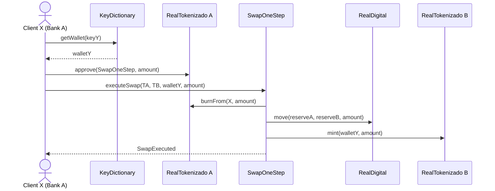
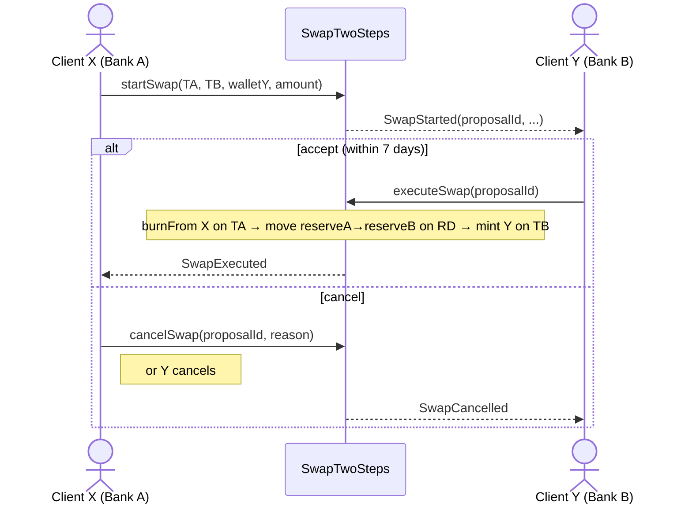

# Use Case Flows

Which contracts and functions to call, in which order and by which wallet, for each use case of the Real Digital (Drex) pilot.

Contracts come from [wireshape/real-digital-smart-contracts](https://github.com/wireshape/real-digital-smart-contracts). For what each contract and function does, see [contracts-reference.md](contracts-reference.md).

## Conventions

- `Contract.function(type name, ...)` — call made **by** the wallet shown on the step. Each argument is written with its Solidity type followed by a descriptive name. `type name = value` shows a suggested literal value.
- `→ type name` — value returned by the call (or read from the event it emits).
- Amounts have **2 decimals**: `10050` = R$ 100,50.
- Actors: **BCB authority**, **BCB admin**, **Participant** (bank, e.g. Bank A / Bank B), **Reserve** (participant wallet holding Real Digital), **Client**.

## Types used

| Solidity type | What it is | How to pass it (ethers.js / web3) |
|---|---|---|
| `address` | 20-byte account or contract address | hex string `"0xAbC…"` (42 chars) |
| `uint256` | unsigned 256-bit integer | `BigInt` / number / decimal string, e.g. `10050n` |
| `bytes32` | 32-byte value, usually a hash | hex string with 64 hex chars, e.g. `ethers.id("RealDigital")` |
| `string` | UTF-8 text | plain string |
| `uint8` | unsigned 8-bit integer (status enum) | number |
| Contract types (`RealDigital`, `RealTokenizado`) | in the ABI they are just `address` | contract address `"0x…"` |

Placeholder names used in the flows:

| Name | Type | Meaning |
|---|---|---|
| `bcbAuthority` | `address` | BCB wallet that gets the operational roles (ACCESS, MINTER, BURNER, MOVER, FREEZER) |
| `bcbAdmin` | `address` | BCB wallet that gets `DEFAULT_ADMIN_ROLE` (manages roles) and `PAUSER_ROLE` |
| `realDigital`, `str`, `swapOneStep`, `swapTwoSteps`, `realDigitalEnableAccount`, `realTokenizadoA`, … | `address` | Address of the deployed contract |
| `participantWallet`, `bankAWallet`, `bankAReserve`, `clientWallet`, `walletY`, … | `address` | Wallet (EOA) address |
| `bankAAuthority`, `tokenAdmin` | `address` | Authority / admin of a `RealTokenizado` |
| `cnpj8` | `uint256` | First 8 digits of the participant's CNPJ, as a number (e.g. `12345678`) |
| `cpf` | `uint256` | Client CPF as a number (leading zeros are lost) |
| `bankNumber`, `account`, `branch` | `uint256` | Participant code, client account and branch, as numbers |
| `amount` | `uint256` | Value with 2 decimals |
| `key` | `bytes32` | Client key in KeyDictionary, e.g. `keccak256(cpf)` |
| `proposalId` | `uint256` | Id of a swap proposal or key request |
| `reason` | `string` | Free-text cancel reason |
| `MINTER_ROLE`, `ACCESS_ROLE`, `MOVER_ROLE`, … | `bytes32` | `keccak256("MINTER_ROLE")` etc. Can also be read from the contract constant (`RealDigital.MINTER_ROLE()`) |

## Index

| # | Use case | Main contracts |
|---|---|---|
| 0 | [Network setup (deploy and role grants)](#0-network-setup) | all |
| 1 | [Onboard a participant](#1-onboard-a-participant) | RealDigital, RealDigitalDefaultAccount, AddressDiscovery |
| 2 | [Participant enables or disables its own wallets](#2-participant-enables-or-disables-its-own-wallets) | RealDigitalEnableAccount |
| 3 | [Change a participant's default wallet](#3-change-a-participants-default-wallet) | RealDigitalDefaultAccount |
| 4 | [Issue Real Digital (STR mint)](#4-issue-real-digital-str-mint) | STR |
| 5 | [Redeem Real Digital (STR burn)](#5-redeem-real-digital-str-burn) | STR |
| 6 | [Inter-bank transfer of Real Digital](#6-inter-bank-transfer-of-real-digital) | RealDigital |
| 7 | [Deploy a participant's Real Tokenizado](#7-deploy-a-participants-real-tokenizado) | RealTokenizado |
| 8 | [Onboard a client](#8-onboard-a-client) | RealTokenizado, KeyDictionary |
| 9 | [Client deposit (issue Real Tokenizado)](#9-client-deposit-issue-real-tokenizado) | RealDigital, RealTokenizado |
| 10 | [Client withdrawal (redeem Real Tokenizado)](#10-client-withdrawal-redeem-real-tokenizado) | RealTokenizado |
| 11 | [Transfer between clients of the same bank](#11-transfer-between-clients-of-the-same-bank) | RealTokenizado |
| 12 | [Transfer between clients of different banks — one step](#12-transfer-between-clients-of-different-banks--one-step) | KeyDictionary, RealTokenizado, SwapOneStep |
| 13 | [Transfer between clients of different banks — two steps](#13-transfer-between-clients-of-different-banks--two-steps) | KeyDictionary, RealTokenizado, SwapTwoSteps |
| 14 | [Key portability between banks](#14-key-portability-between-banks) | KeyDictionary |
| 15 | [Freeze and unfreeze balance (judicial block)](#15-freeze-and-unfreeze-balance) | RealDigital / RealTokenizado |
| 16 | [Forced transfer or forced redemption](#16-forced-transfer-or-forced-redemption) | RealDigital / RealTokenizado |
| 17 | [Emergency pause](#17-emergency-pause) | RealDigital / RealTokenizado |
| 18 | [Discover contract addresses](#18-discover-contract-addresses) | AddressDiscovery |

---

## 0. Network setup

Done once, by BCB, before any other flow.

| Step | Wallet | Call |
|---|---|---|
| 1 | deployer | deploy `RealDigital(string name = "Real Digital", string symbol = "BRL", address bcbAuthority, address bcbAdmin)` → `address realDigital` |
| 2 | deployer | deploy `STR(address realDigital)` → `address str` |
| 3 | deployer | deploy `RealDigitalEnableAccount(address realDigital)` → `address realDigitalEnableAccount` |
| 4 | deployer | deploy `RealDigitalDefaultAccount(address realDigital, address bcbAuthority, address bcbAdmin)` → `address realDigitalDefaultAccount` |
| 5 | deployer | deploy `KeyDictionary(address realDigital)` → `address keyDictionary` |
| 6 | deployer | deploy `SwapOneStep(address realDigital)` → `address swapOneStep` and `SwapTwoSteps(address realDigital)` → `address swapTwoSteps` |
| 7 | deployer | deploy `AddressDiscovery(address bcbAuthority, address bcbAdmin)` → `address addressDiscovery` |
| 8 | BCB admin | `RealDigital.grantRole(bytes32 MINTER_ROLE, address str)` |
| 9 | BCB admin | `RealDigital.grantRole(bytes32 ACCESS_ROLE, address realDigitalEnableAccount)` |
| 10 | BCB admin | `RealDigital.grantRole(bytes32 MOVER_ROLE, address swapOneStep)` and `RealDigital.grantRole(bytes32 MOVER_ROLE, address swapTwoSteps)` |
| 11 | BCB authority | `AddressDiscovery.updateAddress(bytes32 smartContract = keccak256("RealDigital"), address newAddress = realDigital)` — repeat for every contract |

`bcbAuthority` and `bcbAdmin` can be the same wallet in a test network. Role ids are the contract constants: `MINTER_ROLE = keccak256("MINTER_ROLE")`, and so on.

---

## 1. Onboard a participant

A financial institution joins the network.

| Step | Wallet | Call |
|---|---|---|
| 1 | BCB authority | `RealDigital.enableAccount(address participantWallet)` |
| 2 | BCB authority | `RealDigitalDefaultAccount.addDefaultAccount(uint256 cnpj8, address participantWallet)` |
| 3 | (optional) | Enable the reserve wallet too, if different: flow [2](#2-participant-enables-or-disables-its-own-wallets) or step 1 again |
| check | anyone | `RealDigital.verifyAccount(address participantWallet)` → `bool` |

Result: `verifyAccount` returns `true`. The participant can now use STR, KeyDictionary, RealDigitalEnableAccount and transfer Real Digital.

---

## 2. Participant enables or disables its own wallets

| Step | Wallet | Call |
|---|---|---|
| Enable | any enabled participant wallet | `RealDigitalEnableAccount.enableAccount(address newWallet)` |
| Disable | the wallet itself | `RealDigitalEnableAccount.disableAccount()` (no arguments) |

To disable **another** wallet, BCB authority calls `RealDigital.disableAccount(address wallet)`.

---

## 3. Change a participant's default wallet

| Step | Wallet | Call |
|---|---|---|
| 1 | new wallet must be enabled | flow [2](#2-participant-enables-or-disables-its-own-wallets) |
| 2 | current default wallet | `RealDigitalDefaultAccount.updateDefaultWallet(uint256 cnpj8, address newWallet)` |
| check | anyone | `RealDigitalDefaultAccount.defaultAccount(uint256 cnpj8)` → `address` |

---

## 4. Issue Real Digital (STR mint)

Participant converts its bank reserves at BCB (an off-chain balance, not the `reserve` wallet of RealTokenizado) into Real Digital. In the pilot the off-chain debit is not simulated: any enabled participant gets the amount it asks for. The participant does **not** need `MINTER_ROLE`; the STR contract holds it and mints on the participant's behalf.

| Step | Wallet | Call |
|---|---|---|
| 1 | participant (enabled) | `STR.requestToMint(uint256 amount)` |
| check | anyone | `RealDigital.balanceOf(address participantWallet)` → `uint256` |

Requires flow 0 step 8 (STR has `MINTER_ROLE`). Minting also gives STR an allowance of `amount` over the participant's balance, used in flow 5.

---

## 5. Redeem Real Digital (STR burn)

| Step | Wallet | Call |
|---|---|---|
| 1 | participant | `STR.requestToBurn(uint256 amount)` |
| check | anyone | `RealDigital.allowance(address participantWallet, address str)` → `uint256` |

Works up to `RealDigital.allowance(participantWallet, str)`. To burn Real Digital that did not come from STR (e.g. received from another bank), first call `RealDigital.approve(address str, uint256 amount)` (or `increaseAllowance(address str, uint256 amount)`) from the participant.

---

## 6. Inter-bank transfer of Real Digital

Wholesale transfer between participants.

| Step | Wallet | Call |
|---|---|---|
| 0 | anyone | `RealDigital.verifyAccount(address bankBWallet)` → `bool` (must be `true`) |
| 1 | Bank A | `RealDigital.transfer(address bankBWallet, uint256 amount)` → `bool` |

Alternative with a spender: Bank A calls `RealDigital.approve(address spender, uint256 amount)` → `bool`, then the spender calls `RealDigital.transferFrom(address bankAWallet, address bankBWallet, uint256 amount)` → `bool` (both sides must be enabled).

Check that the recipient is enabled first (step 0): `transfer` does not check the recipient, and a non-enabled wallet cannot move the tokens it receives.

---

## 7. Deploy a participant's Real Tokenizado

Each participant has its own tokenized-deposit contract.

| Step | Wallet | Call |
|---|---|---|
| 1 | deployer | deploy `RealTokenizado(string name = "Real Tokenizado Bank A", string symbol = "BRLA", address bankAAuthority, address tokenAdmin, string participant = "Bank A", uint256 cnpj8, address bankAReserve)` → `address realTokenizadoA` |
| 2 | token admin | `RealTokenizado.grantRole(bytes32 MINTER_ROLE, address swapOneStep)` and `RealTokenizado.grantRole(bytes32 MINTER_ROLE, address swapTwoSteps)` |
| 3 | BCB authority | make sure `bankAReserve` is enabled in **RealDigital**: `RealDigital.enableAccount(address bankAReserve)` (or flow 2) |
| 4 | BCB authority | `AddressDiscovery.updateAddress(bytes32 smartContract = keccak256("RealTokenizado@<cnpj8>"), address newAddress = realTokenizadoA)` (naming convention is up to you) |

To change the reserve later: token admin calls `RealTokenizado.updateReserve(address newReserve)`.

---

## 8. Onboard a client

| Step | Wallet | Call |
|---|---|---|
| 1 | Bank A (authority of its RealTokenizado) | `RealTokenizadoA.enableAccount(address clientWallet)` |
| 2 | Bank A (enabled in RealDigital) | `KeyDictionary.addAccount(bytes32 key, uint256 cpf, uint256 bankNumber, uint256 account, uint256 branch, address clientWallet)` |
| check | anyone | `KeyDictionary.getWallet(bytes32 key)` → `address`; `KeyDictionary.getCustomerData(bytes32 key)` → `CustomerData` (tuple below) |

`key` is a `bytes32` chosen by the participant, e.g. `keccak256(cpf)` or `keccak256(email)`. To update the client data, Bank A calls `KeyDictionary.updateData(bytes32 key, uint256 cpf, uint256 bankNumber, uint256 account, uint256 branch, address clientWallet)`.

`CustomerData` is returned as a tuple: `(uint256 taxId, uint256 bankNumber, uint256 account, uint256 branch, address wallet, bool registered, address owner)`.

---

## 9. Client deposit (issue Real Tokenizado)

Client deposits money at Bank A and receives Real Tokenizado A. To keep the token backed, Bank A's reserve should hold the same amount in Real Digital (not enforced by the contracts).

| Step | Wallet | Call |
|---|---|---|
| 1 | Bank A | if needed, get Real Digital into the reserve: `STR.requestToMint(uint256 amount)` from the reserve wallet, or `RealDigital.transfer(address bankAReserve, uint256 amount)` |
| 2 | Bank A (authority of RealTokenizadoA) | `RealTokenizadoA.mint(address clientWallet, uint256 amount)` |
| check | anyone | `RealTokenizadoA.balanceOf(address clientWallet)` → `uint256` |

---

## 10. Client withdrawal (redeem Real Tokenizado)

Pick one option:

| Option | Wallet | Calls |
|---|---|---|
| A — client approves, bank burns | client, then Bank A | client: `RealTokenizadoA.approve(address bankAWallet, uint256 amount)`; Bank A: `RealTokenizadoA.burnFrom(address clientWallet, uint256 amount)` |
| B — forced by the bank | Bank A (`MOVER_ROLE`) | `RealTokenizadoA.moveAndBurn(address clientWallet, uint256 amount)` |
| C — client sends, bank burns | client, then Bank A (`BURNER_ROLE`) | client: `RealTokenizadoA.transfer(address bankAWallet, uint256 amount)`; Bank A: `RealTokenizadoA.burn(uint256 amount)` |

Bank A can then reduce its reserve accordingly (flow 5 or 6).

---

## 11. Transfer between clients of the same bank

No Real Digital moves; only Real Tokenizado A changes hands.

| Step | Wallet | Call |
|---|---|---|
| 1 | anyone | `KeyDictionary.getWallet(bytes32 receiverKey)` → `address receiverWallet` |
| 2 | paying client | `RealTokenizadoA.transfer(address receiverWallet, uint256 amount)` → `bool` |

The receiver must be enabled in `RealTokenizadoA`, otherwise they won't be able to move the funds.

---

## 12. Transfer between clients of different banks — one step

Client X (Bank A) pays client Y (Bank B). All in one transaction.

| Step | Wallet | Call |
|---|---|---|
| 1 | client X | `KeyDictionary.getWallet(bytes32 keyY)` → `address walletY` |
| 2 | client X | `RealTokenizadoA.approve(address swapOneStep, uint256 amount)` → `bool` (or `increaseAllowance(address swapOneStep, uint256 amount)`) |
| 3 | client X | `SwapOneStep.executeSwap(address realTokenizadoA, address realTokenizadoB, address walletY, uint256 amount)` |

In Solidity the first two parameters of `executeSwap` are typed `RealTokenizado`; in the ABI they are `address`.

Event emitted: `SwapExecuted(uint256 senderNumber, uint256 receiverNumber, address sender, address receiver, uint256 amount)`, where the numbers are the CNPJ8 of each bank.

**Preconditions:**

- Flow 0 step 10 and flow 7 step 2 done (swap has `MOVER_ROLE` on RealDigital and `MINTER_ROLE` on RealTokenizado B).
- X enabled in RealTokenizado A with enough unfrozen balance; Y enabled in RealTokenizado B.
- Reserves of A and B enabled in RealDigital; reserve A has ≥ `amount` unfrozen Real Digital.

Result: X −amount (Token A), reserve A −amount (RD), reserve B +amount (RD), Y +amount (Token B).

Step 2 can be skipped for funds X received through a swap, because the swap's `mint` already granted it allowance for that amount.

---

## 13. Transfer between clients of different banks — two steps

Same result as flow 12, but the receiver must accept.

| Step | Wallet | Call |
|---|---|---|
| 1 | client X | `KeyDictionary.getWallet(bytes32 keyY)` → `address walletY` |
| 2 | client X | `RealTokenizadoA.approve(address swapTwoSteps, uint256 amount)` → `bool` |
| 3 | client X | `SwapTwoSteps.startSwap(address realTokenizadoA, address realTokenizadoB, address walletY, uint256 amount)` → read `uint256 proposalId` from the `SwapStarted` event (the function returns nothing) |
| 4a | client Y | `SwapTwoSteps.executeSwap(uint256 proposalId)` — accepts and settles |
| 4b | client X or Y | `SwapTwoSteps.cancelSwap(uint256 proposalId, string reason)` — cancels |
| check | anyone | `SwapTwoSteps.swapProposals(uint256 proposalId)` → tuple below |

Events:

- `SwapStarted(uint256 proposalId, uint256 senderNumber, uint256 receiverNumber, address sender, address receiver, uint256 amount)`
- `SwapExecuted(uint256 proposalId, uint256 senderNumber, uint256 receiverNumber, address sender, address receiver, uint256 amount)`
- `SwapCancelled(uint256 proposalId, string reason)`

`swapProposals` returns `(address tokenSender, address tokenReceiver, address sender, address receiver, uint256 amount, uint8 status, uint256 timestamp)`. `status`: `0` = PENDING, `1` = EXECUTED, `2` = CANCELLED. `timestamp` is in Unix seconds.

Preconditions are the same as flow 12, but checked at step 4a. Balance is not frozen between steps 3 and 4a, so if X spends it or reduces the allowance, step 4a reverts. Proposals older than 7 days can no longer be executed (they stay `PENDING` but can still be cancelled).

---

## 14. Key portability between banks

Client moves their key from Bank A to Bank B.

| Step | Wallet | Call |
|---|---|---|
| 1 | Bank B | `RealTokenizadoB.enableAccount(address newClientWallet)` (flow 8 step 1) |
| 2 | Bank B | `KeyDictionary.requestKey(bytes32 key, uint256 cpf, uint256 bankNumberB, uint256 account, uint256 branch, address newClientWallet)` → read `uint256 proposalId` from the `KeyRequested(address owner, uint256 proposalId, bytes32 key)` event |
| 3 | Bank A (current owner) | `KeyDictionary.authorizeKey(uint256 proposalId, bytes32 key)` within 7 days |
| check | anyone | `KeyDictionary.getCustomerData(bytes32 key)` → `CustomerData`; its `owner` must be Bank B's wallet |

Moving the client's balance from Token A to Token B is a separate step, done with flow 12 or 13.

---

## 15. Freeze and unfreeze balance

Judicial block or temporary hold. Works the same on `RealDigital` (BCB authority) or on a `RealTokenizado` (its authority).

| Step | Wallet | Call |
|---|---|---|
| Freeze | `FREEZER_ROLE` | `Token.increaseFrozenBalance(address wallet, uint256 amount)` |
| Unfreeze | `FREEZER_ROLE` | `Token.decreaseFrozenBalance(address wallet, uint256 amount)` |
| check | anyone | `Token.frozenBalanceOf(address wallet)` → `uint256` |

Event emitted: `FrozenBalance(address wallet, uint256 amount)`, where `amount` is the new total frozen. While frozen, the wallet can only spend `balanceOf - frozenBalanceOf`.

---

## 16. Forced transfer or forced redemption

Moves or destroys a wallet's balance without its signature (e.g. a court order).

| Case | Wallet | Call |
|---|---|---|
| Forced transfer | `MOVER_ROLE` | `Token.move(address from, address to, uint256 amount)` |
| Forced redemption | `MOVER_ROLE` | `Token.moveAndBurn(address from, uint256 amount)` |

If the balance is frozen, unfreeze it first (flow 15): the frozen-balance check also applies here.

---

## 17. Emergency pause

| Step | Wallet | Call |
|---|---|---|
| Pause | admin (`PAUSER_ROLE`) | `Token.pause()` (no arguments) |
| Resume | admin | `Token.unpause()` (no arguments) |
| check | anyone | `Token.paused()` → `bool` |

Pausing `RealDigital` also blocks STR and both swaps (they call `move`/`mint` on it). Pausing one `RealTokenizado` blocks only that bank's clients and swaps involving it.

---

## 18. Discover contract addresses

| Step | Wallet | Call |
|---|---|---|
| 1 | anyone | `AddressDiscovery.addressDiscovery(bytes32 smartContract = keccak256("RealDigital"))` → `address` |
| update | BCB authority | `AddressDiscovery.updateAddress(bytes32 smartContract = keccak256(name), address newAddress)` |

With ethers.js: `addressDiscovery(ethers.id("RealDigital"))`. `ethers.id` returns the `keccak256` of the UTF-8 string as a `bytes32` hex string.
